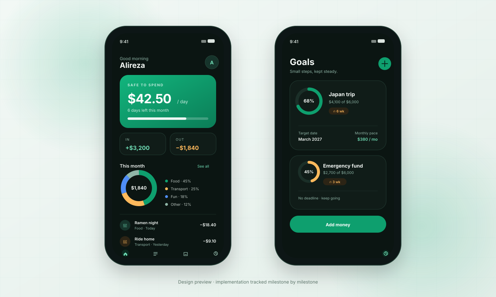
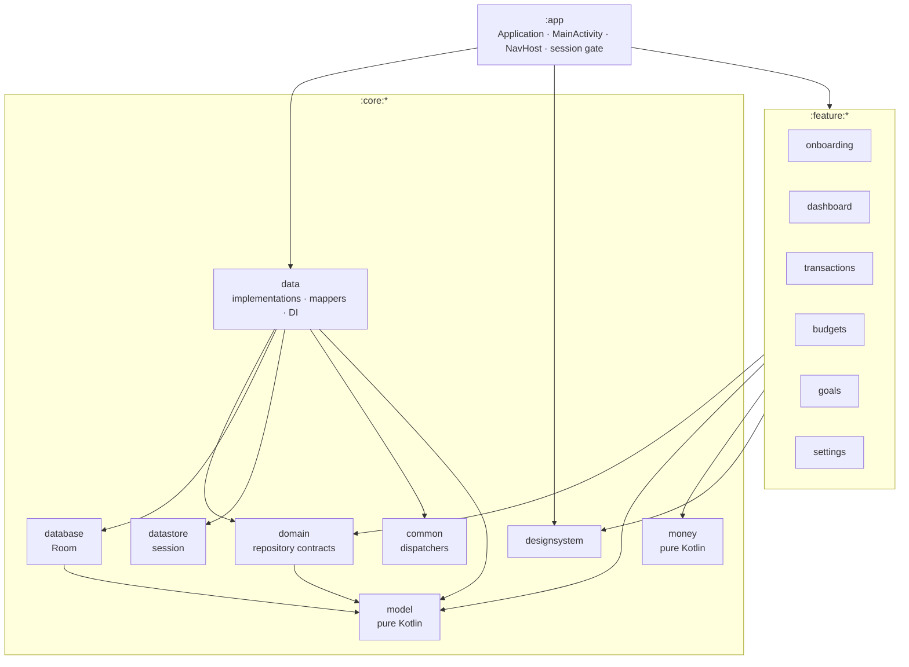

<p align="center">
  
</p>

<h1 align="center">Aram · آرام</h1>

<p align="center">
  <strong>An offline-first Android money companion built around one question: “Can I spend this?”</strong>
</p>

<p align="center">
  <a href="https://github.com/alireza-moradbakhti/Aram/actions/workflows/ci.yml"></a>
  <a href="https://github.com/alireza-moradbakhti/Aram/actions/workflows/release.yml"></a>
  <a href="LICENSE"></a>
  
  
  
</p>

<p align="center">
  <a href="#why-aram">Why</a> ·
  <a href="#architecture">Architecture</a> ·
  <a href="#tech-stack">Stack</a> ·
  <a href="#getting-started">Get started</a> ·
  <a href="#roadmap">Roadmap</a> ·
  <a href="docs/SPEC.md">Spec</a>
</p>

---

Aram is a save-first personal finance app for people who abandon budgeting apps. Instead of dense tables and guilt-driven dashboards, it answers one question with one number: **how much can I safely spend today?**

It is built as a real, production-shaped Android project: multi-module Clean Architecture, MVVM with unidirectional state, an offline Room database designed for a future sync layer, and a CI/CD pipeline that builds, tests, and ships preview APKs from Git tags.

> **Status:** early development. The skeleton (M0) is complete: design system, navigation shell, onboarding, local session, Room schema v1, and CI/CD. Feature work is tracked publicly on the [project board](https://github.com/alireza-moradbakhti/Aram/projects).

## Design preview

<p align="center">
  
</p>

<p align="center"><sub>A design preview of the target experience. Screens are being implemented milestone by milestone.</sub></p>

## Why Aram

| Typical budgeting app | Aram |
|---|---|
| Enter data, browse charts, feel guilty | Answer one question: **“Can I spend this?”** |
| Configuration before the first insight | Value in under 60 seconds |
| Account and cloud required | Fully offline; no account, ever — until sync is added on your terms |
| Dense dashboards | One number, one chart, one next action |
| Red-alarm notifications | Calm visuals, amber warnings, no shaming |

**Target user:** 18–32, saving toward something concrete — a trip, an emergency fund, moving out — and tired of spreadsheets disguised as apps.

## Features

### Shipping in the MVP (P0)

- [x] Local profile, default currency, Gregorian/Jalali calendar preference
- [x] Splash screen, welcome flow, session gate
- [x] Navigation shell with five destinations
- [x] Theme: Material 3, light/dark, edge-to-edge
- [ ] Accounts with opening balances (cash, bank, wallet, savings, investment)
- [ ] Income, expense, and transfer transactions
- [ ] Monthly category budgets with 80% / 100% alerts
- [ ] Savings goals with contributions, streaks, and projected completion
- [ ] Safe-to-spend dashboard
- [ ] Custom Canvas charts: category donut, 6-month trend
- [ ] Search and filter transactions
- [ ] CSV export (P1)

### Deliberately out of scope

- SMS transaction parsing (Play policy risk — CSV import instead)
- Ads, analytics, or any third-party tracking
- Investment portfolio tracking
- Cloud accounts before the local product is finished

## Architecture

Aram uses a multi-module Clean Architecture so that boundaries are enforced by the compiler, not by convention.



**Dependency rules**

- `:feature:*` may depend on `:core:domain`, `:core:model`, `:core:money`, and `:core:designsystem` — **never** on `:core:data` or `:core:database`.
- `:core:domain` depends only on `:core:model` and is pure Kotlin.
- `:core:data` is the only module that knows about Room, DataStore, and repository implementations.
- `:core:model`, `:core:money`, and `:core:common` have no Android dependencies, so they can move to Kotlin Multiplatform later.
- Features never navigate into each other. `:app` wires navigation through lambda callbacks.

**MVVM conventions**

- Each screen is a stateless `*Screen(state, callbacks)` composable — previewable and testable.
- A `*Route` composable owns the `ViewModel` and lifecycle wiring.
- ViewModels expose an immutable `UiState` as `StateFlow`; the UI never mutates state.
- Dependencies point inward: presentation → domain ← data.

```text
*Screen (stateless)
   ↑ state / ↓ events
*Route → ViewModel → StateFlow<UiState>
              ↓
        Repository interface (:core:domain)
              ↓
        Repository impl (:core:data) → Room · DataStore
```

### Engineering decisions

| Decision | Why |
|---|---|
| **Money as `Long` minor units** | No floating-point drift. Every amount is cents/fils/rials; `BigDecimal` is used only at the input boundary with `HALF_UP` rounding. Handles 0-decimal currencies (JPY, IRR). |
| **UUID primary keys + `userId` on every row** | Rows can be created offline and pushed later without a server round-trip. |
| **Soft deletes (`deletedAt`)** | Tombstones survive until a future sync layer reconciles them. |
| **Swappable auth seam** | Features depend on `AuthRepository`; a remote implementation can replace the local one without touching UI modules. See [AuthRepository.kt](core/domain/src/main/java/com/aram/core/domain/repository/AuthRepository.kt). |
| **No INTERNET permission** | Offline privacy is a product guarantee, not an afterthought. Add it only when sync ships. |
| **Custom Canvas charts** | Full control over the calm visual language; no heavyweight chart dependency. |
| **Version catalog + CI** | One source of truth for versions, and every PR proves the build on a clean Ubuntu runner. |

## Tech stack

| Layer | Choice | Version |
|---|---|---|
| Language | Kotlin | 2.4.21 |
| Build | Gradle · AGP (built-in Kotlin) | 9.8.0 · 9.5.1 |
| UI | Jetpack Compose · Material 3 | BOM 2026.09.00 |
| Architecture | MVVM · Clean Architecture · multi-module | — |
| DI | Hilt | 2.60.1 |
| Persistence | Room · DataStore Preferences | 2.8.5 · 1.3.0 |
| Async | Coroutines · Flow | 1.11.0 |
| Navigation | Navigation Compose | 2.10.2 |
| Codegen | KSP | 2.3.14 |
| Testing | JUnit 4 · Turbine · Compose UI Test | — |
| CI/CD | GitHub Actions · JDK 21 · SDK 37 | — |

All versions live in [`gradle/libs.versions.toml`](gradle/libs.versions.toml).

## Project structure

```text
Aram/
├── app/                          # Application, MainActivity, NavHost, session gate
├── core/
│   ├── model/                    # Pure Kotlin domain models + enums
│   ├── money/                    # Money, CurrencyCode, formatting + unit tests
│   ├── common/                   # CoroutineDispatchers abstraction
│   ├── domain/                   # Repository interfaces (AuthRepository, ...)
│   ├── data/                     # Repository impls, mappers, seed data, Hilt modules
│   ├── database/                 # Room entities, DAOs, AramDatabase, schema
│   ├── datastore/                # Session DataStore
│   └── designsystem/             # AramTheme, typography, shared components
├── feature/
│   ├── onboarding/               # Welcome screen + ViewModel
│   ├── dashboard/                # Home screen
│   ├── transactions/             # List + add/edit
│   ├── budgets/                  # Budgets + editor
│   ├── goals/                    # Savings goals
│   └── settings/                 # Profile, currency, calendar
├── docs/                         # Product spec, roadmap, images
├── gradle/libs.versions.toml     # Version catalog
└── .github/                      # CI, release workflow, templates, Dependabot
```

Package root: `com.aram` · application id: `com.aram.app`.

## Getting started

**Prerequisites**

- JDK 21
- Android Studio (latest stable) with Android SDK Platform 37
- An Android 8.0+ (API 26) device or emulator

```bash
git clone https://github.com/alireza-moradbakhti/Aram.git
cd Aram

# Debug APK
./gradlew :app:assembleDebug

# Unit tests (JVM, no device needed)
./gradlew testDebugUnitTest

# Install on a connected device/emulator
./gradlew :app:installDebug
```

The first sync downloads Gradle 9.8 and dependencies. `local.properties` is generated by Android Studio and is not committed.

## Testing

The project follows one rule: **business math is pure Kotlin and fast to test.**

| Layer | Tool | Coverage |
|---|---|---|
| Money & calculations | JUnit 4 | Minor-unit arithmetic, 0-decimal currencies, cross-currency guards |
| Repositories / ViewModels | JUnit + Turbine | Flow emissions, session and validation states |
| DAOs | Room in-memory DB (instrumented) | Queries, soft-delete filters, migrations |
| UI | Compose UI Test | Welcome, navigation shell, transaction form |

```bash
./gradlew testDebugUnitTest
```

## CI/CD

Every push and pull request to `main` runs on a clean Ubuntu runner:

1. Checkout, JDK 21, Android SDK 37
2. `./gradlew :app:assembleDebug testDebugUnitTest`
3. Upload the debug APK and, on failure, the test reports

Pushing a `v*` tag publishes a GitHub Release with a preview APK:

```bash
git tag v0.2.0
git push origin v0.2.0
```

Workflows: [CI](.github/workflows/ci.yml) · [Release](.github/workflows/release.yml). The release APK is debug-signed and clearly marked as a preview until a release keystore is configured.

## Roadmap

| Milestone | Scope | Status |
|---|---|---|
| **M0 · Skeleton** | Multi-module Gradle, theme, splash, welcome, navigation shell, Room v1, local session, CI/CD | ✅ Complete |
| **M1 · Transactions** | Add/edit/delete, list with month headers, account balances, transfers, search & filters, tests | 🔜 Next |
| **M2 · Dashboard** | Safe-to-spend + explainer, month in/out, category donut, 6-month trend, recent transactions | Planned |
| **M3 · Budgets & goals** | Budget CRUD and alerts, goal contributions, streaks, projection, empty states | Planned |
| **M4 · Product polish** | Recurring rules, WorkManager reminders, CSV export, biometric lock, widget, release signing | Planned |

The step-by-step backlog, sprint iterations, and acceptance criteria live on the **[GitHub Project board](https://github.com/alireza-moradbakhti/Aram/projects)**. See [docs/ROADMAP.md](docs/ROADMAP.md) for how the work is sliced.

## Contributing

This is primarily a portfolio and learning project, but feedback and issues are welcome. Read [CONTRIBUTING.md](CONTRIBUTING.md) for branch naming, commit conventions, and the PR checklist.

## Security & privacy

- No data leaves the device; the MVP does not request `INTERNET`.
- No analytics or tracking SDKs.
- To report a vulnerability, see [SECURITY.md](SECURITY.md) — please do not open a public issue.

## License

[MIT](LICENSE) © 2026 Alireza Moradbakhti

---

<p align="center">
  <sub>Built with Kotlin and a strong opinion that calm beats clutter.</sub>
</p>
